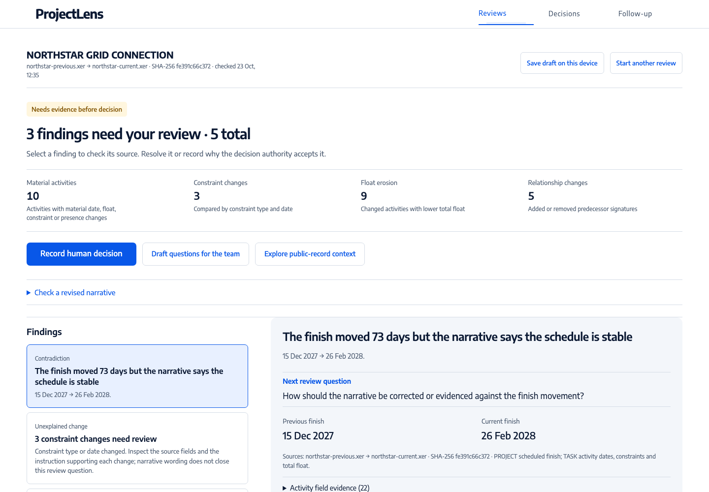
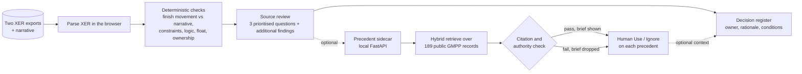

# ProjectLens

Compare a project update with its schedules, inspect what changed, and record the human review decision.

**For:** project managers, project controls reviewers and planners checking a submitted update against two Primavera P6 schedule exports.

**Start here:** [Try ProjectLens](https://matthewpaver.github.io/ProjectLens/change-assurance.html) — no install or account.

1. Select **Try the Northstar example**. Its finish moves by 73 days while the update says unchanged.
2. Inspect the source fields and review questions. Three findings are prioritised; all five remain available.
3. Record a decision with its owner and rationale, then download the evidence-linked record.

Northstar is synthetic. Checks cover supported schedule fields and narrative keywords; they do not establish cause, entitlement or approval.

**Case study:** [The problem, review journey and before-and-after design](https://matthewpaver.github.io/work/projectlens/).

**Technical evidence:** [How the checks work](#how-it-works) · [Results](#results) · [Tests](#repository-layout-and-tests) · [Run locally](#quickstart) · [Limits](#limits-and-non-goals)

[](https://github.com/MatthewPaver/ProjectLens/actions/workflows/deploy-pages.yml)
[](LICENSE)



## The problem

A board often decides on how polished the pack looks, because nobody has time to reconcile the narrative with the schedules, risks, actions and prior conditions submitted with it. The bundled Northstar example reproduces the failure. Its progress report says the "key completion date is unchanged", but the current schedule has moved the finish by 73 days. The change-assurance page checks schedule fields and narrative keywords; the separate board-readiness page covers risks, actions and earlier conditions. If nobody checks the evidence against the story, the board approves the story.

ProjectLens gives the reviewer:

- **Source-linked conflicts and gaps.** Each finding names the evidence that produced it: current or previous schedule fields and the narrative under review.
- **A review tied to source facts.** Three prioritised questions, additional findings retained, and an explicit human decision. Rewording a narrative never removes factual constraint, relationship or float changes.
- **A record of the decision.** The decision, its owner, rationale and conditions are kept; each condition stays open until it is marked closed.

## Quickstart

The browser tool is static HTML and JavaScript. Python's built-in server is enough: no packages, no API keys.

```bash
git clone https://github.com/MatthewPaver/ProjectLens.git
cd ProjectLens
python3 -m http.server 8000 --bind 127.0.0.1 --directory docs
# open http://127.0.0.1:8000/change-assurance.html and select "Try the Northstar example"
```

Expected result: the evidence desk shows three prioritised findings and five total questions, including the 73-day finish movement, with source dates beside the selected finding. Stop the server with Ctrl+C.

**Your own schedules.** Export two single-project XER files from Primavera P6 (**File → Export → Primavera XER**): the comparison point and the latest submission. Select **Use your own schedules**, choose both files and paste the narrative. Files are parsed in the browser and never uploaded. If you have no XER to hand, use the synthetic [Northstar](https://matthewpaver.github.io/ProjectLens/demo/northstar-previous.xer) ([current](https://matthewpaver.github.io/ProjectLens/demo/northstar-current.xer)) or [Riverside](https://matthewpaver.github.io/ProjectLens/demo/riverside-previous.xer) ([current](https://matthewpaver.github.io/ProjectLens/demo/riverside-current.xer), [narrative](https://matthewpaver.github.io/ProjectLens/demo/riverside-narrative.txt)) pairs.

## Guided review

[Take the Northstar walkthrough](https://matthewpaver.github.io/ProjectLens/change-assurance.html?walkthrough=1) to inspect the two bundled XER exports, edit the narrative and rerun the actual checks. Choose a human decision, download the source-linked record and close an owned condition. The guide uses the same parser, checks, form validation and registers as the full application.

Playback starts only when selected and pauses for the human decision, editing or a hidden tab. Reduced-motion visitors use Next. Walkthrough records are held in memory only, separate from saved work; reload or Restart discards them. The downloaded JSON is labelled as a demonstration. The walkthrough makes no causation or approval claim.

The walkthrough journey, isolation, playback, phone layout and failed-load recovery run with `make browser-test` (the focused suite is `Processing/tests/browser_walkthrough.py`).

## How it works



- **Change assurance** (`docs/change-assurance.html`, `.js`): parses both XER files, runs the deterministic checks against the narrative and evidence, and keeps the decision and condition registers in the browser's local storage, with an export of the decision record.
- **Schedule review** (`docs/schedule-review.html`, `docs/xer-review.js`): the detailed XER comparison, reducing raw changes to material ones (on Northstar, 22 raw changes become 9 material changes) with integrity findings.
- **Public evidence** (`docs/index.html`, `Processing/gmpp_pipeline.py`): joins seven annual UK Government Major Projects Portfolio (GMPP) releases into one history of delivery-confidence ratings and end-date changes. Method: [`docs/method.md`](docs/method.md).
- **Precedent sidecar** (`Processing/precedent_rag/`, optional, local): FastAPI plus LangGraph. It retrieves comparable public records with metadata filters and Gemini embeddings. An optional Gemini brief is shown only if every claim cites a retrieved record and it does not recommend approving or rejecting the pack (`summarize.py: evaluate_summary`). It receives narrative text and filters only, never the XER. Method: [`docs/precedent-rag.md`](docs/precedent-rag.md).

To run the sidecar, copy `.env.example` to `.env`, set `GEMINI_API_KEY` (and `LANGSMITH_API_KEY` for traces), then run `make precedent-rag` and set `window.PROJECTLENS_PRECEDENT_RAG_URL = "http://127.0.0.1:8787"` before `change-assurance.js` loads. Without it, the page shows three static precedent cards as optional illustrative context. Untouched cards are recorded as not reviewed; Use or Ignore is required only when you choose to attach or dismiss a record.

## Review, resume and export

The evidence desk puts three prioritised findings (with any additional findings disclosed and retained in the record) beside their source dates, activity movements and original narrative. The decision maker supplies a decision, owner and rationale. Conditional approval also needs a condition, owner and due date. Export preserves findings, the full SHA-256 input identity, original and revised narratives, and optional context dispositions. Use **Check a revised narrative** to rerun a revision against the same exports; unchecked edits do not change decision evidence. Existing records without a hash remain readable and explicitly lack that identity.

**Save draft on this device** deliberately stores both XER contents, narrative and decision fields in browser storage. Save again after further edits; use **Resume saved draft** after reopening, and **Delete saved draft** when finished. Anyone with access to this browser profile may access that stored data. Normal review processing uploads nothing. Browser storage is not a shared or tamper-proof audit system.

Project names and source IDs must match. Identical evidence and reversed data dates are rejected. Missing activity finish or float fields produce an evidence gap. Renamed or re-imported projects need exports with consistent identity before comparison. The narrative checks are bounded keyword heuristics with local negation handling, not semantic understanding; factual changes persist independently of narrative wording; this is not critical-path, causation, entitlement or contractual approval analysis. Validate on representative real exports before operational use.

## Results

**Primary browser review.** `make browser-test` exercises the real parser, comparisons, decision forms and exports on synthetic fixtures. Its seven browser suites cover source-field tracing, revised narratives, required decision details, input identities, drafts, condition closure, invalid-input recovery, keyboard access, reduced motion and phone layouts. [Inspect the browser suite runner](scripts/run_browser_tests.py) and [the verification workflow](.github/workflows/deploy-pages.yml).

`make test` runs the Python regression suite. These authored checks establish behaviour on the included inputs; they do not establish usefulness on representative project exports or observed user task completion.

### Optional public-record retrieval

The following result belongs to the separate local research sidecar, rather than the primary browser comparison.

**Precedent retrieval: hit@5 = 7/8 (88%)** on the offline baseline; hit@3 = 6/8 and hit@1 = 4/8. Reproduced on 2026-10-07:

```bash
make precedent-eval-offline
# or: PYTHONPATH=. .venv/bin/python -m Processing.precedent_rag.cli eval --offline --limit 5
# last line: Hit@5 (offline-hashing): 7/8 = 88%
```

For each of 8 labelled queries in [`eval_queries.json`](Processing/precedent_rag/data/eval_queries.json), it checks whether an expected GMPP record is in the top 5 of the 189-record corpus. It uses the production filter and ranking code with a deterministic SHA-256 token-hashing embedder in place of Gemini, so it needs no key and returns the same number on every run. `test_offline_eval_baseline_is_stable` fails if the number drifts.

What it does not show: 8 author-written queries are a smoke test, not a benchmark. The hashing embedder is a lexical baseline and does not measure the Gemini path (`make precedent-eval`); no Gemini hit rate is published. It scores retrieval only, not the quality of the generated brief.

**Change-assurance behaviour** is checked in a real browser (Playwright). On Northstar the suites assert the 73-day movement, five total questions and three prioritised findings. The landing suite also checks the real-engine preview, keyboard selections, explicit animation and reduced motion, own-file input, revised and original narratives, draft restoration, export, condition closure, five viewport widths and loading recovery. Adversarial narratives cannot erase schedule facts, and “not on track” must not become a stability claim. It also exercises real file inputs, the decision and condition flow, exported packs, and mobile layouts. The XER parser is tested on the Northstar and Riverside fixtures plus synthetic format variants (BOM; LF, CRLF and CR line endings; reordered fields). These are not real client exports; see the [parser compatibility contract](docs/PARSER_COMPATIBILITY.md).

## Design decisions and trade-offs

- **Browser-local comparison, not a hosted platform.** Schedule submissions are commercially sensitive, so XER files, decisions and conditions never leave the machine, and a reviewer can try it on a real pack with no install, account or data-sharing approval. The cost: records live in one browser's local storage, with no multi-user working, permissions or organisational audit log.
- **Deterministic rules for schedule findings, not a language model reading the schedule.** Finish movement against the narrative, constraint, logic and float changes, and responses with no owner are calculated in code, so the same pack always gives the same blockers and each one traces to a field. The cost: it finds only what the rules encode, and it reads XER and CSV only.
- **Retrieval is an opt-in sidecar with no localhost probe.** The static site never tries to reach a local server, so the default page makes no failed requests and needs no key. The cost: live precedent retrieval needs a local setup step and an explicit URL.
- **Generated text fails closed and the human decides.** A brief with an invalid or missing citation, or one that recommends approving or rejecting, is dropped rather than shown with a warning. Each precedent still needs **Use** or **Ignore** before the decision register. The cost: some useful briefs are discarded.
- **A reproducible offline eval alongside the live one.** The hashing-embedder baseline runs in CI with no key and cannot drift silently. The alternative, publishing only a Gemini number, could not be reproduced by a reader without a key. The cost: the published number is a lexical floor, not the production path.

## Limits and non-goals

- Findings prompt human verification. ProjectLens does not establish contractual entitlement, delay causation or a probability of failure, and it does not reproduce Primavera scheduling calculations.
- It does not make the decision. The workflow ends by recording a human decision with its rationale and conditions.
- It reads Primavera P6 XER and CSV only, not Microsoft Project or PDF. Change assurance rejects multi-project XER files; schedule review analyses the first project and says so.
- XER does not reliably carry baseline data (see Oracle's [XER export notes](https://docs.oracle.com/cd/E75426_01/English/User_Guides/p6_pro_user/export_projects_to_an_xer_file.htm)), so baseline assurance needs a separately supplied baseline. Risk and decision links use explicit activity-code matching.
- GMPP delivery-confidence ratings are point-in-time judgements, not outcomes. Annual data cannot support activity-level forecasting, and a project's absence from a later release does not show whether it delivered.
- Precedent relevance is a ranking signal, not a confidence or outcome claim. Public records show status, not which intervention worked.
- A production internal version would need secure schedule connectors, permissions, audit logs and organisation-specific validation.

## Additional tools and walkthroughs

The change-assurance demo above is the main product entry. These supporting routes remain available:

- [Guided Northstar review](https://matthewpaver.github.io/ProjectLens/change-assurance.html?walkthrough=1): a paced version of the same review and decision journey.
- [XER schedule review](https://matthewpaver.github.io/ProjectLens/schedule-review.html): inspect schedule fields directly.
- [Board review](https://matthewpaver.github.io/ProjectLens/board-readiness.html): review risks, actions and earlier conditions.
- [Public GMPP evidence explorer](https://matthewpaver.github.io/ProjectLens/): a separate public-data research tool.
- [Two-minute video walkthrough](docs/assets/projectlens-evidence-demo.mp4).

## Repository layout and tests

```text
docs/                         GitHub Pages site (the product)
  change-assurance.*          change pack review and decision register
  schedule-review.*, xer-review.js   detailed XER comparison
  board-readiness.*           board review preparation
  demo/                       synthetic, share-safe XER and evidence files
  data/gmpp.json              generated public dataset
Data/public/raw/              unmodified annual GMPP CSV releases
Processing/gmpp_pipeline.py   builds and validates docs/data/gmpp.json
Processing/precedent_rag/     optional retrieval sidecar and offline eval
Processing/analysis/, core/   earlier CSV schedule-analysis pipeline (make pipeline)
Processing/tests/             pytest suite and Playwright journeys
```

```bash
make test          # pytest: board gate, GMPP pipeline, precedent RAG, schedule modules
make browser-test  # Playwright journeys on desktop and mobile layouts
make public-data   # rebuild docs/data/gmpp.json from Data/public/raw/
```

Both suites run in [`deploy-pages.yml`](.github/workflows/deploy-pages.yml) before every deploy. Python 3.11. Browser tests need only `requirements-browser.txt`; screenshots go to `/tmp/projectlens-browser` unless `PROJECTLENS_SCREENSHOT_DIR` is set.

## Licence

Code: MIT, see [LICENSE](LICENSE). GMPP source data is Crown copyright, used under the Open Government Licence; source links are in [`Data/public/README.md`](Data/public/README.md).
